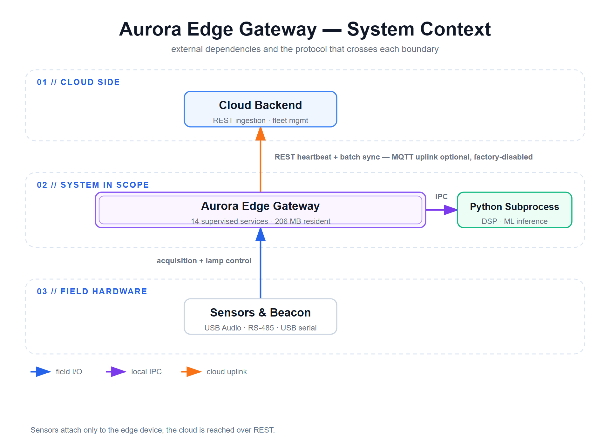
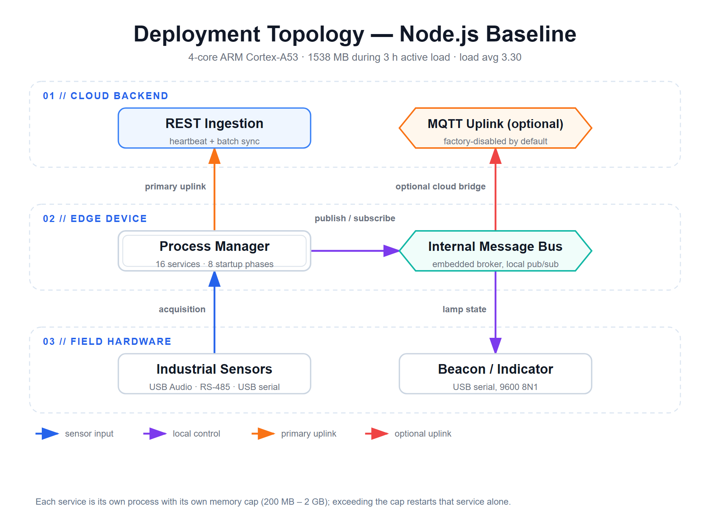
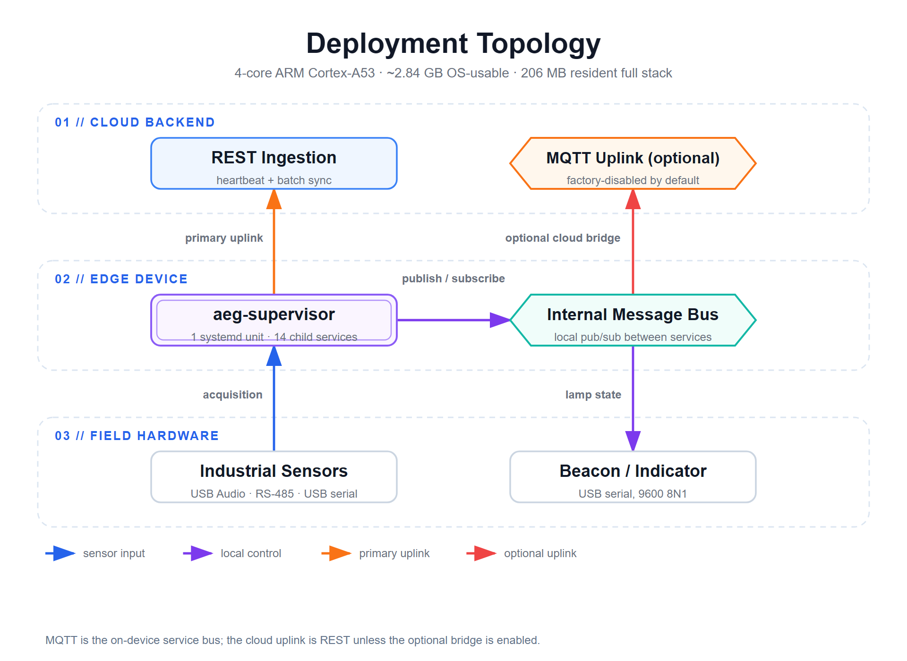
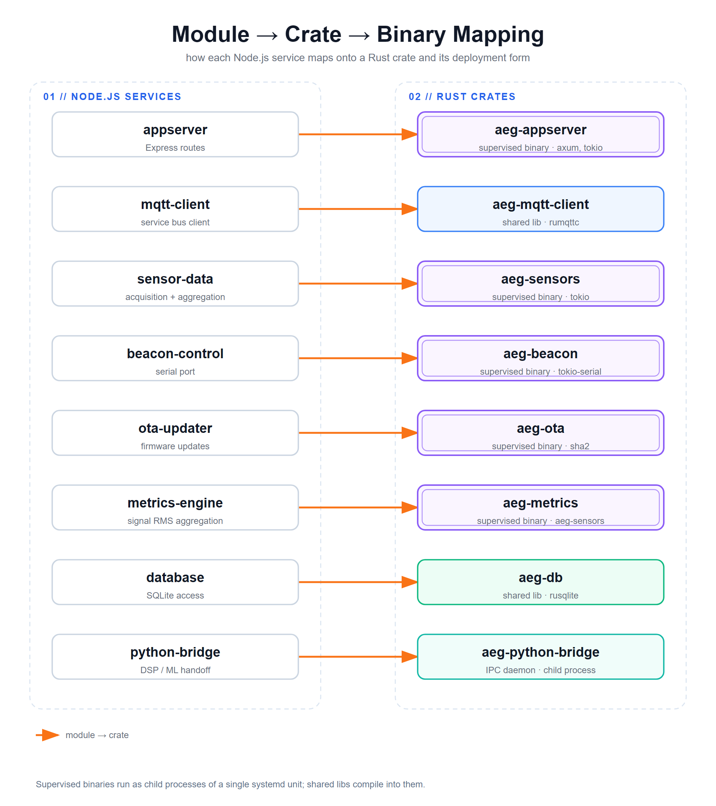
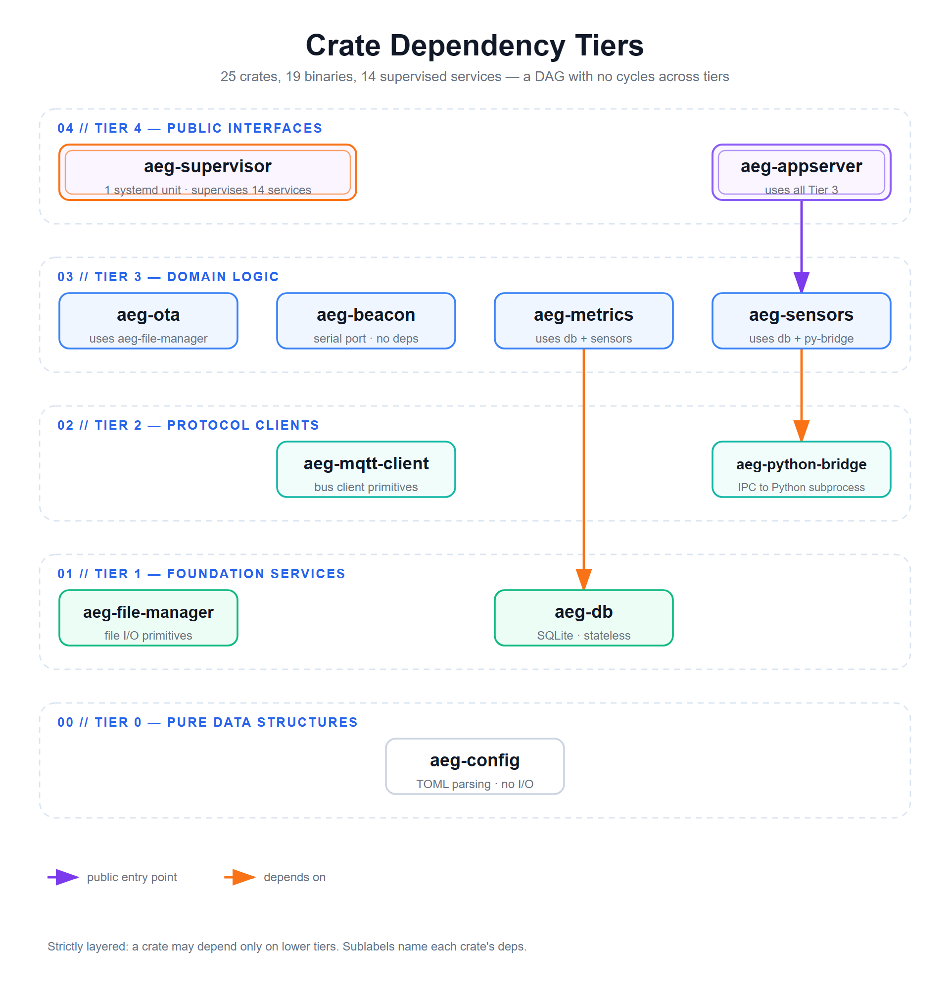
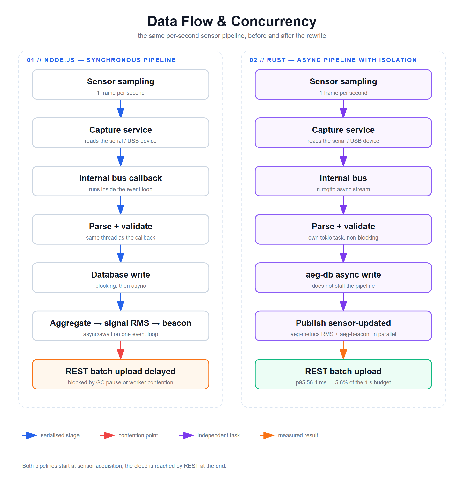

# 架構概覽：Before & After

## 系統上下文

**Aurora Edge Gateway** 是工業 IoT 資料聚合與控制平台，部署在邊緣設備（4 核 ARM Cortex-A53 單板電腦，標稱 4 GB RAM、OS 實際可用約 2.84 GB、無 swap）上。它充當以下之間的橋樑：
- **上游**：雲端後端（資料攝取、車隊管理、分析）
- **下游**：工業感測器與設備——USB Audio（振動擷取）、USB-RS485 上的 Modbus RTU（電流／功率）、USB serial（溫度）、serial（燈塔／指示燈）

### C4 上下文圖



<sub>向量原檔: [`context-diagram.svg`](../diagrams/context-diagram.svg)</sub>

---

## Before：Node.js 架構

### 系統拓樸（原始）



<sub>向量原檔: [`before-topology.svg`](../diagrams/before-topology.svg)</sub>

### 問題

儘管多進程架構提供了基本的故障隔離，但個別進程仍面臨限制：

1. **記憶體佔用**：實機實測。16 個服務 / 8 個啟動 phase 的拓撲（約 20 個 OS 進程）在 3 小時活躍負載窗口下常駐 1538 MB，約佔 4 核產品平台實際可用 2.84 GB 的 54%，且無 swap。每個服務各自扛一份執行環境與 heap 開銷、無法共用，而剩下的餘裕必須同時吸收流量尖峰、感測器數量成長，以及任何單一服務的記憶體行為異常
2. **GC 暫停**：尖峰負載下不可預測的 stop-the-world 延遲，時長隨 heap 大小變化，導致下游超時
3. **缺乏編譯期安全性**：模組邊界上無靜態型別檢查；IPC 和資料驗證中的運行時錯誤
4. **複雜協調**：手動協調進程啟動順序、依賴追蹤和優雅關閉
5. **CPU 開銷**：垃圾收集頻繁運行；進程管理器在約 20 個進程上疊加開銷；實測 CPU 待機 52%、3 小時活躍負載後升至 64%（4 核），load average 3.30——在執行環境層能做的優化有限

---

## After：Rust 架構

### 系統拓樸（Rust 重寫）



<sub>向量原檔: [`deployment-topology.svg`](../diagrams/deployment-topology.svg)</sub>

### 優勢
1. **模組化**：每個 crate/二進位獨立可重啟；故障隔離
2. **記憶體安全**：無未定義行為、無 use-after-free、無資料競爭——全部在編譯期強制。記憶體*增長*是另一回事，靠 soak 測試覆蓋
3. **確定性**：無 GC；所有資源清理明確（drop 語義）
4. **可擴展**：tokio 的 async/await；無線程高效並行
5. **可維護**：強型別在重構時捕捉錯誤
6. **可觀察**：每個服務記錄到 systemd journald；易於集中監控

---

## 模組 → Crate → 二進位對照



<sub>向量原檔: [`module-crate-mapping.svg`](../diagrams/module-crate-mapping.svg)</sub>

### 範例對照

| 原 Node.js 模組 | Rust Crate | 受監督二進位 | 依賴 |
|---|---|---|---|
| appserver（Express 路由） | `aeg-appserver` | `aeg-appserver` | axum, tokio, serde, aeg-db |
| mqtt-client | `aeg-mqtt-client` | (shared lib) | rumqttc, tokio |
| sensor-data | `aeg-sensors` | `aeg-sensors` | aeg-db, aeg-mqtt-client, tokio |
| beacon-control（序列埠） | `aeg-beacon` | `aeg-beacon` | tokio-serial, tokio |
| file-manager | `aeg-file-manager` | (shared lib) | tokio, anyhow |
| ota-updater | `aeg-ota` | `aeg-ota` | sha2, aeg-file-manager |
| metrics-engine（訊號 RMS 聚合） | `aeg-metrics` | `aeg-metrics` | aeg-sensors, aeg-db |
| configuration | `aeg-config` | (build-time) | serde, toml |
| database | `aeg-db` | (shared lib) | rusqlite, tokio |
| python-bridge | `aeg-python-bridge` | (IPC daemon，子行程) | tokio, serde |

上述每個二進位皆以子行程形式在單一 `aeg-supervisor` systemd unit 下執行，並非各自獨立的 systemd unit（總計 14 個受監督服務）。

---

## 技術選擇：npm → Rust

詳見 **[ADR-0004：生態系 Crate 對照](adr/0004-ecosystem-crate-mapping.md)** 了解詳細理由

| 領域 | Node.js (npm) | Rust (crates.io) | 理由 |
|---|---|---|---|
| HTTP 伺服器 | express | axum | 零成本抽象；型別安全路由 |
| MQTT | mqtt (npm) | rumqttc | 異步優先；更好的嵌入式使用案例支持 |
| SQLite | better-sqlite3 | rusqlite | 同步 API 足以；無 GC |
| 異步運行時 | node（原生） | tokio | 業界標準；優秀的並行 |
| 日誌 | winston | tracing + slog | 結構化日誌；journald 整合 |
| 序列化 | JSON（原生） | serde | 零成本序列化 |
| 序列埠通訊 | serialport (npm) | tokio-serial / serialport | 異步序列埠 I/O；符合實際硬體（USB 序列埠控制燈塔——本硬體平台沒有 GPIO 腳位） |
| 跨編譯 | n/a | cargo（內建） | ARM 目標原生支持 |

---

## Before vs. After 對比

| 特徵 | Node.js（基線） | Rust（目標） | 說明 |
|---|---|---|---|
| **進程架構** | 進程管理器管理 16 個服務，分 8 個啟動 phase（實機另觀測到約 20 個進程） | 14 個服務以子行程形式受單一 `aeg-supervisor` systemd unit 監管 | 更清晰的故障邊界；編譯期型別安全 |
| **記憶體使用** | 4 核產品平台、3h 活躍負載下 1538 MB（約佔可用 2.84 GB 的 54%） | 全棧 206 MB（14 個受監督服務 + Python 子行程，帶 1 顆振動感測器） | 顯式清理，無 GC 堆積增長 |
| **CPU 使用** | 待機 52% / 3h 活躍負載 64%（4 核計） | 7.8h soak 平均 6.3% / 峰值 8.8%，整晚零漂移 | 確定性效能，無 GC 暫停抖動 |
| **Load Average** | 3.30 / 4 核（3h 活躍負載） | 7.8h soak 平均 0.50 / 峰值 1.81（全程 < 2 核） | 餘裕空間大 |
| **編譯期安全** | IPC 邊界上僅運行時檢查 | 完整編譯期驗證 | 在部署前捕捉邊界錯誤 |
| **進程協調** | 手動進程管理器風格協調，搭配逐服務記憶體上限（200 MB–2 GB，超限自動重啟）與依賴追蹤 | 單一 supervisor 拉起並監管 14 個子行程服務；IPC 走內部訊息匯流排（不是 systemd socket activation） | 更簡單、標準的 OS 層級管理；既有的逐服務重啟能力被保留，而非被取代 |
| **重啟影響** | 進程管理器可針對單一服務獨立重啟（例如撞上記憶體上限時），不影響其他服務 | Supervisor 針對受影響服務獨立重啟；soak 測試頭 66 分鐘內觀測到 3 次重啟，之後 6.7h 零重啟 | 兩種架構都把重啟範圍限制在受影響服務——這本來就不是 Node.js 的弱點 |
| **正常運行時間可預測性** | 穩態就吃掉可用記憶體的 54%，逐服務記憶體上限成了持續增長與強制重啟之間唯一的緩衝 | 7.8h soak 浮現配置器層級的增長，已診斷並修復（`MALLOC_ARENA_MAX=2`）；10.6h 重跑以負斜率收尾 | 增長變成可診斷的對象，而不是被重啟吸收掉 |
| **記憶體安全** | 僅運行時檢查；未定義行為可能 | 編譯期保證；無未定義行為 | 消除整類記憶體損毀漏洞 |
| **API 破壞性變更** | 無 | 無（向後相容） | 即插即用替代品 |
| **實施努力** | 基線（已部署） | 約 22 週（Stage 0–4 分階段推出；Phase A 移植工作主要集中於 Stage 0–2） | 編譯期安全與可靠性收益值得投入 |

---

## Crate 架構圖

參見 `../diagrams/module-crate-mapping.svg` 了解完整 crate 依賴圖（DAG 結構）

### 依賴層



<sub>向量原檔: [`crate-dependency-tiers.svg`](../diagrams/crate-dependency-tiers.svg)</sub>

---

## 部署拓樸

參見 `../diagrams/deployment-topology.svg` 了解邊緣到雲端拓樸

### 邊緣設備 Systemd Unit

```
[aeg-supervisor]
ExecStart=/usr/local/bin/aeg-supervisor --config /etc/aeg/supervisor.toml
Restart=always
RestartSec=5

# aeg-supervisor 拉起並監管 14 個子行程服務，包括：
#   aeg-appserver、aeg-sensors、aeg-metrics、aeg-ota、aeg-beacon、
#   aeg-db、aeg-file-manager、aeg-python-bridge、aeg-mqtt-client、
#   aeg-config，以及 log/輪替、看門狗、閾值同步等輔助服務。
```

設備上只有這一個 systemd unit。在它之下：
- Supervisor 可針對單一子服務獨立重啟，不影響其他服務
- 每個服務有可設定的記憶體上限，由 supervisor 強制（超限自動重啟）
- 各服務透過 supervisor 記錄到 systemd journal
- 服務間透過內部訊息匯流排（本機 MQTT broker）通訊，而非原始 Unix sockets 或 TCP

---

## 資料流與並行



<sub>向量原檔: [`data-flow-pipeline.svg`](../diagrams/data-flow-pipeline.svg)</sub>

**伺服端管線實測**（285 個逐秒樣本）：中位 55.5 ms / p95 56.4 ms / p99 57.7 ms / max 59.5 ms——約佔每秒預算的 5.5–5.6%，且無任何樣本超過 500 ms。伺服端分項：JSON 反序列化 18.1 ms + RMS 計算 ×3 軸 3.7 ms + 診斷計算 13.7 ms = 35.5 ms。

---

## 後續步驟

1. **遷移策略** → 參見 `03-migration-strategy.zh-TW.md` 了解兩階段移植方案
2. **測試與驗證** → 參見 `04-testing-strategy.zh-TW.md` 了解 golden-master 測試
3. **決策理由** → 參見 **[ADR-0002](adr/0002-module-to-crate-decomposition.md)** 和 **[ADR-0003](adr/0003-hybrid-runtime-keep-python-subprocess.md)** 了解架構決策
4. **視覺圖表** → 參見 `../diagrams/` 目錄

---

**最後更新**：2026-10-20  
**狀態**：基線架構已批准  
**下次審查**：Phase A 完成後（golden-master 測試結果）
