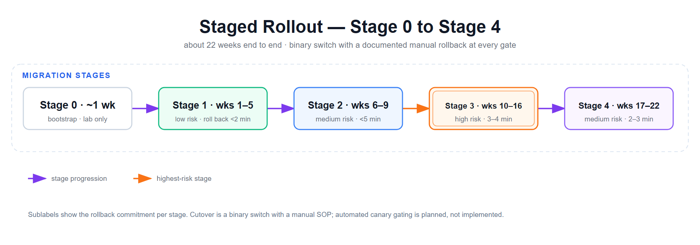

# 遷移策略：兩階段方法與分階段推出

## 概觀

從 Node.js 到 Rust 的遷移以**約 22 週的分階段推出（Stage 0–4）**執行，每個階段都有二元回滾開關與人工 SOP（整體回滾在 5 分鐘內完成，各階段 2–4 分鐘）。Phase A（忠實搬遷）與 Phase B（強化優化）並非接在這段時程前面的獨立區段，而是貫穿 Stage 0–4 整個時程的兩種方法論視角：每個模組在其部署所屬的 Stage 上線前先經過忠實搬遷（Phase A）；待對等性確認後，強化與優化工作（Phase B）則在後續 Stage 中持續進行。此方法降低風險，同時維持行為兼容。

### 兩階段哲學

**Phase A（忠實搬遷）**：精確複製行為，包括漏洞和怪癖，以建立高置信度基線。  
**Phase B（強化與優化）**：重構、修正已知問題，並在對等性驗證後優化。

關注點分離很關鍵：混合重構與搬遷引入正交變數，使測試難以追蹤。

---

## Phase A：忠實搬遷（主要落在 Stage 0–2）

### 目標
達成 100% **行為等價**與 Node.js 基線，透過 golden-master 測試驗證生產流量重放。

### 方法

#### 1. 模組對模組分析與搬遷
依賴序序處理模組（Tier 0 → 4；見架構概觀）：

**Tier 0：基礎**
- `aeg-config` — TOML 解析與配置綱要
- 目標：完全相同的配置格式；相同的預設值；相同的錯誤訊息

**Tier 1：基礎服務**
- `aeg-db` — SQLite 包裝函式庫
- `aeg-file-manager` — 檔案 I/O 原語
- 目標：相同的 SQL 查詢；相同的檔案路徑；相同的錯誤處理

**Tier 2：通訊協議用戶端**
- `aeg-mqtt-client` — MQTT 原語（rumqttc 周圍的非同步包裝函式庫）
- `aeg-python-bridge` — 與 Python 子程序的行程間通訊
- 目標：相同的主題訂閱；相同的訊息格式；相同的 Python 命令列引數

**Tier 3：領域邏輯**
- `aeg-sensors`、`aeg-metrics`（訊號 RMS 聚合）、`aeg-led`、`aeg-ota`
- 目標：完全相同的感測器讀數值；相同的 LED 顏色/亮度；相同的 OTA 邏輯

**Tier 4：公開介面**
- `aeg-appserver` — REST API 路由與 HTTP 回應格式
- 目標：完全相同的 REST 端點、狀態碼、回應 JSON 綱要

#### 2. 標記慣例以追蹤
使用一致的標記標誌延遲決策和已知問題**搬遷期間**：

| 標記 | 用途 | 範例 |
|---|---|---|
| `TODO(port)` | 延遲至 Phase B 的工作 | `TODO(port): Refactor error handling per ADR-0005` |
| `FIXME(port)` | Node.js 中的已知漏洞，我們在此複製 | `FIXME(port): RISK-003 — sensor reads drop 0.1% under peak load` |
| `PERF(port)` | 延遲至 Phase B 的優化機會 | `PERF(port): Replace Vec with circular buffer for lower allocation` |
| `SAFETY:` | 記憶體安全或安全稽核標記 | `SAFETY: Bounds-checked input; no buffer overflow possible` |

所有標記都在可搜尋的標記普查中被追蹤（CI 閘門：`grep -r "TODO(port)"` 必須在 Phase B 前少於 100 次符合）。

#### 3. Golden-Master 測試
見 **[ADR-0006](adr/0006-golden-master-testing.md)** 與 `04-testing-strategy.md` 以取得完整方法論。

**高階過程：**
1. 記錄 3+ 週的生產流量（MQTT 訊息、REST API 呼叫、感測器讀數、時間戳）
2. 在關鍵點檢測 Node.js 二進制檔以捕獲所有內部狀態（DB 寫入前/後、感測器讀取等）
3. 針對 Rust 二進制檔執行相同流量；在相同關鍵點比較輸出
4. **目標**：100% 符合所有可觀察輸出（REST 回應、MQTT 訊息、檔案寫入、DB 狀態）

#### 4. 風險分類
在程式碼審查期間標誌的每個模組有指定的風險等級：

| 風險等級 | 特徵 | 範例 | 緩解 |
|---|---|---|---|
| **LOW** | 簡單資料轉換；無副作用 | JSON 序列化、配置解析 | 單元測試即足夠 |
| **MEDIUM** | 某些 I/O 或狀態變化；語意清晰 | 資料庫查詢、檔案寫入 | 樣本資料的 Golden-master 測試 |
| **HIGH** | 複雜並行、密碼學或商業邏輯 | MQTT 事件聚合、韌體更新 | 廣泛的 golden-master 測試 + 壓力測試 |

### Phase A 成功準則
- ✓ 所有模組已搬遷；0 個 `FIXME(port)` 項目未解決
- ✓ Golden-master 測試套件在 ≥ 3 週生產流量上通過
- ✓ 無新漏洞引入（問題計數 < Node.js 基線）
- ✓ 行為等價性在 100% REST API 端點上建立
- ✓ 記憶體與 CPU 分析基線為 Phase B 比較而捕獲

---

## Phase B：強化與優化（主要落在 Stage 2–4）

### 目標
修正已知漏洞、優化效能，並改善可靠性。所有變更針對 Phase A 基線驗證以防止衰退。

### 方法

#### 1. 處理所有 `TODO(port)` 與 `FIXME(port)` 標記
- `FIXME(port)` → 修正故意複製的已知漏洞（例如，RISK-003）
- `TODO(port)` → 實施延遲的重構與優化

**範例修正：**
- **RISK-003（感測器在負載下掉線）**：實施優先隊列 + 背壓以防止 MQTT 突發期間的訊息遺失
- **RISK-007（OTA 逾時）**：新增網路逾時搭配指數退避而非無限等待
- **RISK-012（LED 閃爍）**：去抖動 GPIO 更新；新增畫幀速率限制

#### 2. 效能優化
問題陳述中的目標指標：

| 指標 | Phase A（Node.js 基線，4 核 ARM Cortex-A53，3 小時活躍負載） | Phase B（Rust，7.8 小時 soak 實測，同一硬體） | 方法 |
|---|---|---|---|
| **記憶體（活躍）** | 1538 MB 活躍（約佔可用 2.84 GB 的 54%）；16 個服務 / 8 個啟動階段，約 20 個進程 | 206 MB 全棧常駐（14 個受監督服務 + Python 子行程） | 將 Node.js 逐進程的記憶體開銷收斂為一組精簡的受監督 Rust 服務 |
| **CPU** | 待機 52%、3h 活躍 64% | 平均 6.3%、峰值 8.8%，整個 soak 期間零漂移 | 消除事件迴圈／GC 爭用；分析熱路徑 |
| **Load average（4 核）** | 3.30 平均（3h 活躍） | 平均 0.50、峰值 1.81（7.8h soak） | 維持餘裕；無 GC 暫停（Rust 無 GC） |
| **系統記憶體餘裕** | 未單獨追蹤；已知案例——某次資料欄位擴充造成 RSS +13 MB/h，約 14 小時後撞 500 MB 單服務上限自動重啟，穩態 CPU p90 由約 140% 升至 169.5%（4 核計） | 系統可用記憶體 6024 → 5885 MB／7.8h（−139 MB）；soak 測試中找到並修復的唯一一次持續增長問題詳見 `04-testing-strategy.zh-TW.md` | soak 測試才能抓到單元測試看不到的配置器／執行環境層級增長 |
| **重啟／啟動穩定性** | 逐服務記憶體上限（200 MB–2 GB）觸發自動重啟；開機至全服務上線約 2 分 30 秒 | 頭 66 分鐘內重啟 3 次（啟動穩定期），之後 6.7 小時零重啟；目前最長的乾淨 soak 為 10.6 小時 | 受監督啟動流程；詳見 `04-testing-strategy.zh-TW.md` |
| **GC 暫停** | 0（V8 有 GC，但不是這裡的瓶頸） | 0（Rust 無 GC） | 不適用 |

#### 3. 強化與可靠性
- **錯誤處理**：將 panic 替換為優雅降級（重試、備用、告警）
- **逾時**：為所有 I/O 操作新增全面逾時處理
- **監控**：新增個別服務 Prometheus 指標；設定告警
- **Systemd 整合**：新增健康檢查（Ping 端點、DB 連接、MQTT Broker 連接）

#### 4. 測試演變
- Phase A 測試保持不變（防止衰退）
- 為重構程式碼新增單元測試
- 執行延長壓力測試（48+ 小時負載測試、記憶體 soak 測試）
- 驗證 Phase B 修正不破壞 Phase A 對等性

### Phase B 成功準則
- ✓ 所有 `TODO(port)` 與 `FIXME(port)` 標記已解決或重新分類
- ✓ 效能目標達成：CPU 平均 6.3%／峰值 8.8%（7.8h soak，4 核 ARM Cortex-A53）；全棧常駐記憶體 206 MB（14 個受監督服務 + Python 子行程）；Load average 平均 0.50／峰值 1.81（4 核）
- ✓ 目前最長的連續 soak 測試（10.6h）通過，soak 期間抓到的記憶體增長問題已修復，末段 2 小時斜率轉負（詳見 `04-testing-strategy.zh-TW.md`）。備註：本專案其他地方提到的「90 天」僅指憑證輪替週期，與 uptime 要求無關。
- ✓ Phase A golden-master 對等性維持（無衰退）
- ✓ 團隊充分訓練且信心十足地使用 Rust 程式碼庫

---

## 分階段推出：Stage 0–4（約 22 週）

### 哲學
遞增式部署搭配自動化安全閘門；每個階段可在 < 1 分鐘內回滾。



<sub>向量原檔: [`staged-rollout-timeline.svg`](../diagrams/staged-rollout-timeline.svg)</sub>

---

### Stage 0：啟動與基礎設施（第 0 週，低風險）

**目標**：將 Rust 二進制檔與 systemd 基礎設施部署到測試機隊；驗證無服務啟動問題。

**範圍：**
- 部署 aeg-config（配置解析器，無執行時變更）
- 部署 aeg-db（資料庫層，無 API 變更）
- 測試：systemd 能否啟動與管理 Rust 二進制檔？二進制檔記錄正確嗎？

**回滾觸發：**
- 任何服務無法啟動
- Systemd 健康檢查失敗
- 記憶體使用超過 50 MB 空閒

**回滾程序：**
```
# 在測試裝置上
systemctl stop aeg-*
# 將 Rust 二進制檔替換為 Node.js 二進制檔
systemctl start node-gateway
# 驗證 REST API 與 MQTT 流量恢復
```

**持續時間**：1 週；部署到 5–10% 機隊（低風險測試裝置）  
**通過/不通過閘門**：所有測試裝置穩定 7 天；零服務重啟

---

### Stage 1：低風險服務（第 1–5 週，低風險）

**目標**：部署獨立服務，無上游依賴。

**範圍：**
- 部署：`aeg-led`（GPIO 控制）— 隔離；無資料依賴
- 部署：`aeg-config`（配置服務）
- 測試：這些服務能否與 Node.js 並執行？是否有資源衝突？

**回滾觸發：**
- 服務重複崩潰
- 偵測到記憶體洩漏（監控中觀察到持續正斜率的 RSS 增長，而非啟動期的暫態波動——偵測方法詳見 `04-testing-strategy.zh-TW.md`）
- GPIO 控制失敗（LED 未回應）

**回滾程序：**
```
systemctl stop aeg-led aeg-config
# Node.js 恢復控制
```

**持續時間**：約 4 週（第 1–5 週）；部署到 20–30% 機隊  
**通過/不通過閘門**：所有 Stage 1 裝置穩定；LED 控制 100% 功能；零記憶體洩漏

---

### Stage 2：中等風險服務（第 6–9 週，中等風險）

**目標**：部署事件串流與韌體更新服務；測試訊息交付與 OTA 可靠性。

**範圍：**
- 部署：`aeg-mqtt`（MQTT 用戶端、事件串流）
- 部署：`aeg-ota`（韌體更新）
- 測試：負載下的訊息交付？OTA 更新可靠性？雲端連接？

**回滾觸發：**
- MQTT 訊息遺失 > 0.1%（嚴重資料喪失）
- OTA 更新失敗或留下裝置於不良狀態
- 雲端 API 連接失敗
- 逐秒管線延遲超過 soak 測試觀察到的 500 ms 預算上限（Phase B 實測 p95 為 56.4 ms，佔每秒預算 5.6%，285 個樣本，詳見 `04-testing-strategy.zh-TW.md`），或相對此基線呈持續上升趨勢

**回滾程序：**
```
systemctl stop aeg-mqtt aeg-ota
# 驗證無韌體損毀
# 從檢查點恢復 MQTT 工作階段
# Node.js 恢復
# 通知雲端後端恢復輪詢（備用模式）
```

**持續時間**：約 4 週（第 6–9 週）；部署到 40–50% 機隊  
**通過/不通過閘門**：100% 訊息交付、零失敗 OTA 更新、100% 雲端連接、零資料喪失

---

### Stage 3：高風險服務——振動、溫度與感測器資料（第 10–16 週，高風險）

**目標**：部署有狀態的振動／溫度／感測器資料服務；測試持久性與並行。此為整個推出計畫中風險最高的階段。

**範圍：**
- 部署：`aeg-sensors`（感測器聚合、DB 寫入）
- 部署：`aeg-metrics`（訊號 RMS 聚合，例如電錶讀數計算）
- 測試：DB 寫入衝突？感測器讀數準確性？資料一致性？

**回滾觸發：**
- 感測器讀數與 Node.js 基線偏差（> 1% 誤差）
- 資料庫損毀或查詢失敗
- 逐秒管線延遲超過 500 ms 預算上限，或任何樣本明顯高於 Phase B soak 基線（p95 56.4 ms，佔每秒預算 5.6%；詳見 `04-testing-strategy.zh-TW.md`）

**回滾程序：**
```
systemctl stop aeg-sensors aeg-metrics
# 驗證 DB 未損毀
sqlite3 /var/lib/aeg/data.db "PRAGMA integrity_check"
# 若需要回滾 DB 至檢查點
# Node.js 恢復
```

**持續時間**：約 7 週（第 10–16 週）；部署到 60–70% 機隊  
**通過/不通過閘門**：感測器讀數 100% 準確；零 DB 損毀事件；延遲在實測預算範圍內

---

### Stage 4：轉換與完整遷移——REST 應用伺服器（第 17–22 週，中等風險，回滾視窗 = 48h）

**目標**：完整機隊遷移；Node.js 二進制檔退役。

**範圍：**
- 部署：`aeg-appserver`（REST API，取代 Node.js appserver 進程）
- 停用：Node.js 程序（進程管理器）
- 測試：完整功能對等；所有 API 用戶端功能正常

**回滾觸發（48h 視窗）：**
- 任何服務崩潰
- 逐秒處理管線超過 500 ms 預算上限，或 p95 明顯高於 Phase B soak 基線（56.4 ms，佔每秒預算 5.6%；詳見 `04-testing-strategy.zh-TW.md`）；`aeg-appserver` 是整個推出計畫中單一最大的遷移單位，因此這是最關鍵的一道閘門
- 記憶體使用持續上升、未回落至基線（全棧常駐基線為 206 MB；斜率判斷方法詳見 `04-testing-strategy.zh-TW.md`）
- 資料損毀事件

**回滾程序（緊急）：**
```
# 搭配 Node.js 快速重啟（systemd ExecStart=...）
systemctl stop aeg-appserver
systemctl set-environment NODE_GATEWAY_ENABLED=1
systemctl start node-gateway
# 所有 Rust 服務保持執行（不衝突）
# 雲端後端自動偵測透過健康檢查容錯轉移
```

**持續時間**：約 6 週（第 17–22 週）；48 小時回滾視窗  
**通過/不通過閘門**：
- 處理管線維持在實測預算內：p95 ≤ 56.4 ms（佔每秒預算 5.6%；Phase B 285 個樣本實測），超過 500 ms 的次數為 0
- MQTT 心跳間隔維持（無訊息遺失）
- 24 小時內零服務重啟
- 記憶體穩定在 206 MB 全棧基線附近，無持續上升斜率

**推出後（第 23+ 週）：**
- 監控機隊 2 週
- 若穩定：退役 Node.js 二進制檔；停用進程管理器
- 若有問題：延長監控與除錯

---

## 自動化安全閘門（CI/CD 整合）

在每個階段，自動化測試必須通過才能部署繼續：

```yaml
# CI 管道虛擬程式碼
stages:
  - build:
      script: cargo build --release --target aarch64-unknown-linux-gnu
      
  - test-phase-a:
      script: |
        # 執行生產流量上的 golden-master 測試
        ./golden-master-harness < production-traffic.json
        if [ $? -ne 0 ]; then exit 1; fi
        
  - test-phase-b:
      script: |
        # 效能目標——門檻值錨定於 Phase B soak 基線
        # （p95 56.4 ms，佔每秒預算 5.6%；全棧常駐 206 MB）
        perf-benchmark > results.json
        if results.json latency_p95_ms > 500; then exit 1; fi  # 預算上限；285 樣本基線測試中 0 次超過
        if results.json memory_slope_mb_per_hour > 0; then exit 1; fi  # 標記任何持續正斜率——這正是找出 arena 增長問題的方法（詳見 04-testing-strategy.zh-TW.md）
        
  - marker-census:
      script: |
        # 確保所有標記已計算
        todo_count=$(grep -r "TODO(port)" . | wc -l)
        fixme_count=$(grep -r "FIXME(port)" . | wc -l)
        if [ $todo_count -gt 0 ]; then exit 1; fi
        
  - stage-0-deploy:
      script: |
        # Stage 0 預先檢查
        - Verify systemd units load without error
        - Check for library conflicts
        - Validate config file format
        
  - stage-1-deploy:
      script: |
        - Verify LED control works (GPIO integration)
        - Check memory footprint < 50MB
        
  - stage-2-deploy:
      script: |
        - Run MQTT message loss test (expect 0 loss)
        - Run OTA update simulation
        - Cloud connectivity health check
        
  - stage-3-deploy:
      script: |
        - Verify sensor readings match Node.js baseline (< 1% error)
        - Check DB integrity post-write
        - Golden-master test on sensor sample data
        
  - stage-4-deploy:
      script: |
        - Processing pipeline latency test (p95 within the 56.4 ms / 5.6%-of-budget baseline)
        - 24-hour load test (no crashes)
        - Memory soak test (flag any sustained positive RSS slope per service; see 04-testing-strategy.zh-TW.md)
```

---

## 回滾決策樹

```
偵測到事件
    ↓
自動健康檢查失敗？
    ├─ 是 → 自動回滾（< 1 分鐘）
    │       ├─ 終止 Rust 服務
    │       ├─ 恢復 Node.js/備用
    │       └─ 告警團隊
    │
    └─ 否（需要人工干預）
         ├─ 這是資料一致性問題？
         │   └─ 是 → 從檢查點恢復 DB；回滾
         │
         ├─ 這是暫時網路故障？
         │   └─ 是 → 等待 5 分鐘；觀察；決策
         │
         └─ 這是基礎不兼容？
             └─ 是 → 回滾至先前階段
```

---

## 時間軸與資源需求

| 階段 | 持續時間 | 機隊規模 | 回滾視窗 | 團隊負載 |
|---|---|---|---|---|
| Stage 0 | 約 1 週（第 0 週） | 5–10 裝置 | 10 分鐘 | 1 待命工程師 |
| Stage 1 | 約 4 週（第 1–5 週） | 20–30 裝置 | 10 分鐘 | 1 待命工程師 |
| Stage 2 | 約 4 週（第 6–9 週） | 40–50 裝置 | 1 小時 | 2 待命工程師 |
| Stage 3 | 約 7 週（第 10–16 週，高風險） | 60–70 裝置 | 2 小時 | 2 待命工程師 |
| Stage 4 | 約 6 週（第 17–22 週） | 100% 機隊 | 48 小時 | 3 待命工程師 |
| **專案總計** | **約 22 週（Stage 0–4）** | **漸進式** | **遞減後 48h** | **變動** |

Phase A（忠實搬遷）與 Phase B（強化與優化）並非額外加上去的時程——它們描述的是 Stage 0–2（搬遷＋golden-master 驗證）與 Stage 2–4（強化＋效能調校）期間「正在進行哪種工作」。兩者與分階段推出是並行進行的，不是接續在其之前的獨立區段。

---

## 通訊計畫

### 內部（團隊）
- 日常站立會議於 Stages 0–4
- 週度推出準備審查
- 推出後事件審查（無指責）

### 外部（客戶）
- 預先宣告："計畫性效能改善即將推出"
- Stage 2 以後：監控指標儀表板（透明進度）
- 推出後：發布附註描述改善

---

## 後續步驟

1. **測試方法論** → 見 `04-testing-strategy.md` 以取得 golden-master 測試設計
2. **審查流程** → 見 `05-review-process.md` 以取得多角色程式碼審查
3. **決策理由** → 見 **[ADR-0005](adr/0005-staged-rollout-and-rollback.md)** 以取得完整決策記錄

---

**最後更新**：2026-10-20  
**狀態**：遷移策略已批准  
**下次審查**：第 8 週（Phase A 完成）
